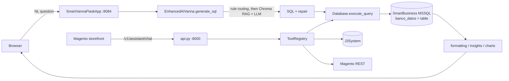

# Repository Guidelines

## Project Overview

Python BI platform for Depotru hardware-store operations (Colombia). Two products share one source tree:

- **Vanna NL→SQL web UI** — Spanish natural-language questions over SmartBusiness MSSQL, served on `:8084`.
- **FastAPI BFF** — legacy analytics routes plus a platform `/v1` surface for the Magento storefront assistant, served on `:8000`.

SmartBusiness (`banco_datos`, `banco_cartera`, `productos_adicional`) is the BI database. J3System is a second MSSQL database used for inventory, quotes, accounting, OTIF, and electronic invoices. The Magento storefront `depositotrujillo.co` is a sibling system reached only through adapters.

Declared version `2.1.0` (`pyproject.toml`). Python floor `>=3.9`; CI tests 3.9–3.11. Code and docs are English; user-facing strings, reports, and AI prompts are Colombian Spanish.

## Architecture & Data Flow



**NL→SQL path.** `src/vanna_grok.py:main` builds one `EnhancedAIVanna`, connects to MSSQL, and calls `train_vanna()` → `business_analyzer.ai.training.full_training` (DDL, documentation rules, J3 schema, golden SQL) into Chroma. A request enters `EnhancedAIVanna.generate_sql`, which:

1. Resolves follow-up context and deterministically routes known intents (manager reports, J3 warehouse questions, branch/brand questions) to SQL templates before any LLM call.
2. Otherwise calls Vanna/Chroma/LLM through a per-provider circuit breaker.
3. Repairs generated SQL, including forcing the canonical document-code exclusion.
4. Executes through `get_database()` → `Database.execute_query`, then formats for display.

**Providers.** `AI_PROVIDER` defaults to `grok`; `create_ai_client` supports `grok`, `openai`, `deepseek`, `anthropic`, `ollama`, `openrouter`, `groq`, and `commandcode`. Provider classes in `ai/providers/` are not used by the live factory; the factory constructs clients inline in `ai/base.py::create_ai_client`.

**REST path.** `src/api.py` creates the FastAPI app, mounts `apps.api.v1.router` at `/v1`, and adds legacy routes. `/v1` handlers call `depotru_tools.registry.ToolRegistry`, whose builtins reach SmartBusiness, J3, Magento, or the assistant. The assistant is deterministic-first (`modules/assistant/chat.py`), with an optional Grok tool loop (`modules/assistant/llm_router.py`) limited to public tools. Tool scope is enforced by `depotru_kernel.auth.Audience`.

**Platform spine status.** `depotru_kernel`, `depotru_tools`, `depotru_integrations`, `modules/assistant`, and `apps/api/v1.py` are real and tested. `modules/bi`, `modules/crm`, `modules/wms`, and `modules/catalog` are scaffolds or re-exports. There is no plugin discovery and no DI container. Legacy `business_analyzer` remains the bulk of BI logic and is not being replaced.

**Database access.** `business_analyzer.core.database.Database` is the canonical connection manager (direct MSSQL via pymssql, pyodbc fallback, optional Navicat `.ncx` decryption, pooling, retries). `core.db_factory.get_database()` returns a per-thread instance; callers must not share `Database` objects across threads. `data_access/banco_datos.py` is a legacy fetch path used by `business_analyzer_combined.py`.

## Key Directories

| Path | Purpose |
|---|---|
| `src/business_analyzer/ai/` | Vanna runtime (`base.py`), training, provider clients, Colombian formatting, charts, insights, Flask app, circuit breakers. |
| `src/business_analyzer/core/` | `Database`, `db_factory`, query cache, paths, J3 runners, warehouse policies, `*_cli.py` report CLIs. |
| `src/business_analyzer/analysis/` | Metric analyzers, manager report package, affinity engines, anomaly/predictive/OTIF logic. |
| `src/business_analyzer/reports/` | Monthly report CLI, HTML/PDF/matplotlib renderers, AI narratives, cartera/rotación/KPI/TSOL builders. |
| `src/depotru_kernel/` | Stable contracts: documents, money, auth audiences, models, attribution. |
| `src/depotru_tools/` | `ToolRegistry`, scope enforcement, builtin tools. |
| `src/depotru_integrations/` | Magento REST client and affinity CSV contract. |
| `src/modules/assistant/` | Storefront assistant routing, problem guides, optional LLM loop, JSONL logging. |
| `src/apps/api/v1.py` | FastAPI `/v1` adapter. |
| `src/analytics/`, `src/contracts/`, `src/data_access/`, `src/reporting/` | Extracted helpers used by the legacy `business_analyzer_combined.py`; do not treat as canonical for new code. |
| `tests/` | pytest suite, split by domain (`ai`, `analysis`, `core`, `platform`, `reports`, `utils`, `mcp`, `integration`). |
| `scripts/{analysis,reports,utils,ops}/` | Production report wrappers, KPI automation, Vanna maintenance, BFF/Magento ops. |
| `data/sql/` | Index/mart DDL. Other `*.sql` is gitignored. |
| `deploy/` | BFF/tunnel and systemd units; `docs/` holds platform and reference docs. |

Ignore `.worktrees/**` duplicate trees when searching or editing; scope changes to the repository root.

## Development Commands

```bash
# Install
pip install -e ".[dev]"
pip install -e ".[dev,mcp]"              # Python >=3.10, needed for MCP tests/server
pip install -e ".[cache]"                # Redis query cache

# Main Vanna UI (http://localhost:8084)
python src/vanna_grok.py
PORT=8085 python src/vanna_grok.py
PRODUCTION_MODE=true python src/vanna_grok.py      # Waitress

# FastAPI BFF (http://localhost:8000)
python src/api.py
PYTHONPATH=src .venv/bin/python -m uvicorn api:app --host 0.0.0.0 --port 8000

# Reports and MCP
depotru-report --year 2026 --month 10 --format text
depotru-report --year 2026 --month 10 --format html --output reports/report_2026_10.html
depotru-db-mcp
uv run --with-editable . --with mcp python -m business_analyzer.mcp.database_server

# Tests (pytest.ini supplies -v --tb=short --strict-markers)
pytest tests/ -v
pytest tests/ -v -m "not requires_db and not requires_api"          # CI-safe
pytest tests/platform -v
pytest tests/platform/test_kernel.py::test_excluded_codes_canonical -v

# Live MSSQL integration (real .env; bypasses both conftests)
pytest tests/integration/ -m requires_db --noconftest -v

# Lint/type check — CI-equivalent
black --check --diff --extend-exclude "(src/business_analyzer/ai/training.py|tests/ai/test_stability.py|tests/test_metabase_connection.py)" src/ tests/ examples/
isort --check-only --diff --skip-glob "*.backup" --skip-glob "src/business_analyzer/ai/training.py" --skip-glob "tests/ai/test_stability.py" --skip-glob "tests/test_metabase_connection.py" src/ tests/ examples/
flake8 src/ tests/ examples/ --exclude src/business_analyzer/analysis/customer_optimized.py --count --select=E9,F63,F7,F82
mypy src/business_analyzer/ai/training.py src/business_analyzer/analysis/alerts.py --follow-imports=skip --ignore-missing-imports

pre-commit install
pre-commit run --all-files
```

`make test` and `make lint` default to `.venv` (override with `VENV=<path>`); `make lint` mutates files. Do not run report scripts against production DBs without confirming their flags; several are destructive (`generate_presupuesto_2026.py --apply`, `refresh_affinity_mart.py`, `run_website_stock_allowlist_sync.py` without `--dry-run`, `retrain_vanna.py --reset`).

## Code Conventions & Common Patterns

**Imports and layout.** `src/` is the package root for setuptools; runtime imports are top-level (`from config import Config`, `from business_analyzer.core.database import Database`). New code must not use `src.` prefixes. `PYTHONPATH=src` / `pythonpath = src` is required in tests and systemd. New platform code uses `from __future__ import annotations`, dataclasses for value objects, and Pydantic only at HTTP boundaries.

**Configuration.** Two distinct `Config` classes exist:
- `src/config.py::Config` — DB, `EXCLUDED_DOCUMENT_CODES`, `OUTPUT_DIR`, `DEFAULT_LIMIT`, `REPORT_DPI`.
- `src/business_analyzer/ai/base.py::Config` — provider keys/models, `HOST`/`PORT`, insights toggles, import-time validation.

`require_env()` calls `sys.exit(1)`, not raises. Do not call it from library code or tests; use `os.getenv(..., default)` with explicit validation. `get_env_or_test_default()` bypasses validation under pytest, `TESTING=true`, or any stack filename containing "test", so green tests do not prove production env configuration.

**Error handling.** Use the existing exception types: `DatabaseError`, `ConnectionError`, `QueryError` (`core/database.py`), `ToolNotFoundError`, `ToolPermissionError` (`depotru_tools/registry.py`), `CircuitBreakerError`. Use `retry_on_failure(max_attempts=3, ...)` for external AI calls; DB calls already retry transient connection errors. Tool and assistant handlers intentionally catch broad exceptions to keep chat alive — do not copy that pattern into core or DB code.

**SQL safety.** Use `%s` parameters for all user values. Validate identifiers with `validate_sql_identifier` (`core/database.py`) before interpolation. LLM-generated SQL is repaired, not parameterized: `_ensure_document_exclusion` rewrites `DocumentosCodigo NOT IN (...)` for `banco_datos` queries to the canonical five codes. MCP is read-only by default (`SELECT`/`WITH` only; `EXEC` and stacked `;` blocked unless `ALLOW_WRITE=1`). There is no equivalent guard on Vanna `run_sql`, so never add a code path that lets an LLM write.

**Canonical business filter.** Always exclude test/non-commercial documents via `depotru_kernel.documents.CANONICAL_EXCLUDED_DOCUMENT_CODES`, currently `("XY", "AS", "TS", "YX", "ISC")`, or `Config.EXCLUDED_DOCUMENT_CODES` which matches. `excluded_document_sql_in_list()` builds the SQL fragment. The three-code form still appears in `analysis/anomaly.py`, `analysis/engines/text_similarity.py`, legacy Vanna training, and old docs — do not copy it.

**Data semantics.**
- `banco_datos` is a table, 38 columns, ~1.58M sales-line rows per `reports/DATABASE_TABLE_DECISION_SUMMARY.md`. Key fields: `Fecha`, `ano`/`mes`/`periodo`, `DocumentosCodigo`, `TercerosNombres`, `ArticulosCodigo`/`ArticulosNombre`, `AlmacenCodigo`, `vendedor_codigo`, `VendedorAsignado`, `categoria`, `subcategoria`, `marca`, `proveedor`, `TotalSinIva`, `TotalMasIva`, `ValorCosto`, `Cantidad`.
- Branches are document codes, not customers: `FED` = Almacén Principal, `FEF` = Sika Center (warehouse `FLO`), `FET` = Calle 5 / Distribuciones. Never query Sika Center by customer name.
- Negative `Cantidad` and return document codes are returns; include them unless the question explicitly excludes returns.
- Profit = `TotalSinIva - ValorCosto`; margin = profit / `TotalSinIva`; IVA = `TotalMasIva - TotalSinIva`.
- Manager reports exclude own-company customers and non-sellable products (`manager_report/helpers.py`). Keep those exclusions when reusing queries.
- Quote tools quote net prices before IVA, refuse the `006 AL COSTO` tariff, allow at most 20 SKUs, and fail closed. Website stock excludes warehouses `CEN, EXH, EXD, BDT, MDL, TRA`.

**Formatting.** BI display uses `business_analyzer.ai.formatting.format_number`, `format_dataframe`, `format_currency`, `format_percentage` → `$1.234.567`, `45,6%`, `-` for null. Platform/kernel code uses `depotru_kernel.money.format_cop` and `format_pct`. Never hand-roll separator replacement. `safe_divide` is duplicated by module; import the local one or inject it, do not create a new global copy.

**Dependency injection and async.** There is no DI framework. Pass collaborators explicitly; tool handlers receive `ToolContext`, and the registry is the lazy singleton `get_default_registry()`. FastAPI `Depends` is used only for auth. Patch seams are module-level functions such as `db_factory.get_database` and `create_ai_client`. BI code is synchronous; legacy `api.py` routes offload blocking DB work with `run_in_executor`, while `/v1` handlers currently call sync tool/DB code directly — use the offload pattern for any new blocking route.

**State and concurrency.** The single `EnhancedAIVanna` instance is shared across threaded Flask/Waitress requests and stores `_last_question`, `_last_result_df`, and `_manager_report_result`; treat those as request-scoped and avoid relying on them across calls. There is no Flask session and no conversation store; assistant `session_id` is echoed only, and turns are appended to JSONL.

**Caching.** `CACHE_BACKEND=memory|redis` and `CACHE_TTL_SECONDS` configure the SQL cache; Redis failure falls back to memory. The Flask UI keeps its own question-keyed cache of SQL, DataFrames, charts, and report payloads. Report narratives use a SHA-256 disk cache under `~/.cache/depotru-report-narratives`.

**Naming.** Modules are `snake_case`; CLIs are `*_cli.py`; J3 SQL builders are `j3system_*.py`; one-off runners live in `scripts/analysis/run_*.py`. New public contracts belong in `depotru_kernel`; new cross-channel capabilities belong in `depotru_tools.registry`.

## Important Files

| File | Role |
|---|---|
| `src/vanna_grok.py` | Main UI entry; `EnhancedAIVanna`; Flask/Waitress launch. |
| `src/api.py` | FastAPI app and legacy BI routes; mounts `/v1`. |
| `src/apps/api/v1.py` | Platform routes, API-key/audience auth, tool invocation. |
| `src/business_analyzer/ai/base.py` | Provider factory, rule SQL routing, SQL repair, retries, manager-report routing. |
| `src/business_analyzer/ai/training.py` | Vanna DDL/docs/example training; contains canonical field mappings and branch rules. |
| `src/business_analyzer/ai/formatting.py` | Colombian number/DataFrame formatting. |
| `src/business_analyzer/ai/flask_app.py` | SmartVanna Flask app; report/chart/KPI routes. |
| `src/business_analyzer/core/database.py` | Connections, pooling, retries, query execution, identifier validation. |
| `src/business_analyzer/core/db_factory.py` | Thread-local `get_database(reuse=True)`. |
| `src/config.py` | Runtime DB/output configuration and excluded document codes. |
| `src/business_analyzer/analysis/manager_report/` | Monthly manager report pipeline (`report.py`, `queries.py`, `aggregations.py`, `helpers.py`). |
| `src/business_analyzer/reports/monthly.py` | `depotru-report` implementation. |
| `src/business_analyzer/mcp/database_server.py` | Read-only-by-default stdio MCP SQL server. |
| `src/depotru_kernel/documents.py` | Canonical document exclusions — import this, don't hardcode. |
| `src/depotru_kernel/auth.py` | `Audience`, `ToolScope`, `scopes_for_audience`. |
| `src/depotru_tools/registry.py` | `ToolRegistry`, `ToolContext`, scope enforcement, lazy singleton. |
| `src/modules/assistant/chat.py` | Deterministic storefront assistant and hybrid entry. |
| `pytest.ini` | Effective pytest config (shadows `pyproject.toml`). |
| `.flake8` | Effective flake8 config (shadows `[tool.flake8]`). |

Legacy or non-canonical: `src/vanna_chat.py` and `src/vanna_integration/` import the pre-2.x Vanna namespace (`vanna.flask`, `vanna.openai`, `vanna.chromadb`, ...), which is absent from the locked Vanna 2.x install; the packaged `vanna-chat` entry actually maps to `vanna_grok:main`. `src/business_analyzer_combined.py` is runnable as `python -m src.business_analyzer_combined` from the repo root. `dist/` wheels are stale. Do not use `src/config.py` being labeled "legacy" in the README as a reason to remove it — it is imported across core and reports.

## Runtime/Tooling Preferences

- **Python:** declared `>=3.9`; CI 3.9–3.11; local `.venv` is 3.12; production `.venv-production` is 3.14. Keep new syntax 3.9-compatible.
- **Packaging:** setuptools + PEP 621. `pip install -e` and `uv` (via `uv.lock`) are both supported; no Poetry. `setup.py` and `requirements.txt` are legacy and narrower/stale relative to `pyproject.toml`.
- **Tools:** black 23.12.1 (88 cols), isort 5.13.2 in CI/pre-commit (`profile=black`, `known_first_party=["src"]`), flake8 (88 cols, ignores `E203,W503`), mypy 1.x (`>=1.8,<2`) targeting 3.9 with `ignore_errors` for most of `business_analyzer`. `uv.lock` resolves isort 8.x, which sorts differently — use the pinned 5.13.2 for `--check-only` parity with CI.
- **Config ownership:** `pytest.ini` is the only pytest config; `.flake8` is the only flake8 config; coverage lives in `pyproject.toml`.
- **Ports:** Vanna UI `8084`; API/BFF `8000`; MSSQL `1433`.
- **Containers/ops:** only `Containerfile` (Podman), no compose. It uses `requirements.txt`, lacks a `.dockerignore`, runs as root, and does not install the project; systemd units under `deploy/` and root `*.service` assume specific paths. Treat them as deployment artifacts, not development entry points.

Required environment for the main app: `DB_HOST`, `DB_PORT`, `DB_NAME`, `DB_USER`, `DB_PASSWORD`, plus the selected provider key (`GROK_API_KEY` by default, which must start with `xai-`). The README and `.env.example` say `DB_SERVER`; the main app does not read it. `DB_PORT` and `DB_NAME` are required at import by `ai/base.py`, even though `src/config.py` has defaults. `NCX_FILE_PATH` does not replace direct DB vars for the Vanna app.

Useful optional variables: `AI_PROVIDER`, `PRODUCTION_MODE`, `HOST`, `PORT`, `API_KEY`, `PLATFORM_API_KEYS` (`key:audience,...`), `OUTPUT_DIR`, `CACHE_BACKEND`, `REDIS_URL`, `DB_NAME_J3SYSTEM`, `DB_TABLE`, `ALLOW_WRITE` (MCP only), `ASSISTANT_LLM`, `ASSISTANT_CHAT_LOG`.

Never commit `.env`, `.ncx`, `chroma.sqlite3`, generated reports, or credentials. Archived docs under `docs/archive/` contain plaintext credentials; do not copy them into prompts, code, or new docs.

## Testing & QA

`pytest` with `pytest-asyncio` in auto mode. Tests are organized by domain under `tests/`; older suites (`tests/ai`, `tests/core`, parts of `tests/analysis`) lean on test classes, while newer `tests/platform`, `tests/reports`, `tests/utils`, and `tests/integration` are function-style with fixtures. Root `tests/conftest.py` globally replaces `pymssql`, `pyodbc`, `NavicatCipher`, `Crypto`, and the `config` module with mocks, so:

- The default suite never reaches a real DB or AI provider.
- `pytest.importorskip("pymssql")` always succeeds because the mock is installed.
- `tests/integration/` is skipped automatically under those mocks. Use `--noconftest -m requires_db` with a real `.env` to run it.
- Tests importing `src.config` bypass the mock and load the developer's real `.env`; do not rely on that for isolation.

Shared fixtures are only `sample_transaction_data` and `empty_data`. For other cases, follow local patterns: a `FakeDB` with `execute_query`, `monkeypatch` on `db_factory.get_database`, `TestClient(api.app)` for FastAPI, `SmartVannaFlaskApp(...).flask_app.test_client()` for Flask, `monkeypatch.setenv`/`tmp_path`, and `reset_default_registry()` when exercising tools. Canonical row shape: `TotalMasIva`, `TotalSinIva`, `ValorCosto`, `Cantidad`, `TercerosNombres`, `ArticulosNombre`, `categoria`, `Fecha`.

**CI gates** (`.github/workflows/ci.yml`):
- test matrix 3.9/3.10/3.11, running `-m "not requires_db and not requires_api"` with coverage XML;
- black/isort over `src/ tests/ examples/` with the three excluded files;
- flake8 blocking only `E9,F63,F7,F82` (the full pass is `--exit-zero`);
- mypy on only `ai/training.py` and `analysis/alerts.py`;
- bandit with `B608` (SQL injection) and `B314` (XML parsing) skipped, failing only on HIGH;
- build + `twine check`.

There is **no coverage threshold** and no `fail_under`; the 80–85% targets in older docs are aspirational. `tests.yml` is deprecated but still runs a second matrix on Python 3.10–3.12.

Do not break content-coupled tests: `scripts/analysis/kpi_sql_pack.sql.template` (Q1–Q18 assertions), `docs/reference/j3system-sales-warehouse-query.md`, `reports/DATABASE_TABLE_DECISION_SUMMARY.md`, and literal training examples are asserted by tests. After any behavior change, run the narrowest relevant test and a smoke invocation of the changed entry point; for DB/report work, use `--json`/`--dry-run` alternatives where available.
